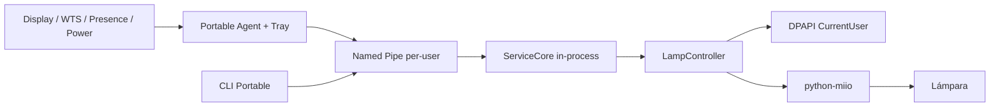
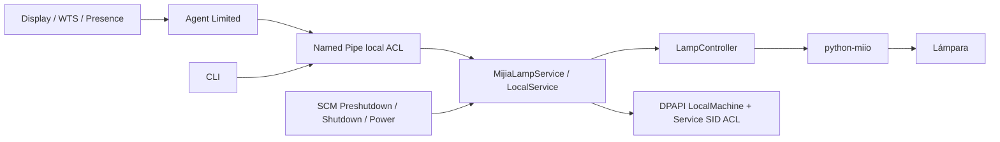

# MijiaLamp

[English](README.md) | [Español](README.es.md)

Automatización local para lámparas Xiaomi/Mijia compatibles con `python-miio` en Windows 10/11.

**MijiaLamp** ofrece dos modos sobre el mismo núcleo de policy/controller:

| | Portable | Hardened Service |
|---|---|---|
| Administrador | No | Sólo instalación/mantenimiento |
| Windows Service | No | Sí (`LocalService`) |
| Token | DPAPI `CurrentUser` | DPAPI `LocalMachine` + ACL Service SID |
| Display/WTS/User Presence | Sí | Sí |
| Tray y notificaciones | Sí | Sí |
| Sync físico/perfiles solares | Sí | Sí |
| Funciona sin sesión iniciada | No | Sí |
| Puede iluminar la pantalla de inicio de sesión antes de entrar a Windows | No | Sí, con `service_prelogin_display` (pendiente de prueba real en Session 0) |
| Preshutdown/Shutdown SCM | Best effort | Sí |
| Runtime Python | `.venv` del usuario | Copia privada, inmutable para el usuario |
| Recomendado para | uso personal/simple | máxima fiabilidad y aislamiento |

> El repositorio público no contiene IP, DID, MAC, coordenadas, token ni estado de una instalación real.

## Instalación y configuración con interfaz

En Windows, descargá y extraé **`MijiaLamp-Setup-<version>.zip`** y abrí **`setup-gui.vbs` con doble clic desde el Explorador**, como usuario normal. Se abre el asistente sin una terminal detrás. `setup-gui.cmd` también sigue disponible como lanzador.

El recorrido inicial es **Idioma → Modo → Lámpara → Configuración → Instalar → Listo**. Elegí inglés o español en la primera pantalla; la selección se guarda como `ui_language` y podés cambiarla más adelante en Preferencias. Para aplicar allí el idioma nuevo, guardá y volvé a abrir Preferencias. La interfaz, las ayudas, la bandeja, las notificaciones y los errores de la aplicación usan el idioma elegido; los errores que genera Windows u otro componente externo pueden conservar su idioma original. El paquete Setup permite elegir Portable o Service; los ZIPs específicos incluyen sólo su modo. En «Lámpara», conectá Mi Home mediante QR y elegí el dispositivo: se comprueban IP, modelo y DID en la red local y se cifra el token. Podés cambiar de lámpara usando la misma lista mientras el asistente siga abierto; actualizar la lista requiere otro QR.

En «Configuración», buscá tu **ciudad** y confirmá un resultado: se completan zona horaria, latitud, longitud y altitud. El buscador mundial usa [Open-Meteo / GeoNames](https://open-meteo.com/en/docs/geocoding-api), sin cuenta ni clave; sólo envía el nombre buscado, nunca el token o datos de la lámpara. Si una localidad no aparece, elegí una cercana o configurá la ubicación manualmente en Opciones avanzadas. La lámpara sigue funcionando sin Internet después de configurar la ubicación.

Elegí **hora de dormir**, **sólo de noche o todo el día**, y **seguir la pantalla (incluye bloqueo) o exigir una sesión desbloqueada**. En Service, seguir la pantalla permite iluminar antes de iniciar sesión; Portable necesita haber iniciado sesión. Con la reducción automática, la luz baja desde dos horas antes de dormir y queda tenue hasta el amanecer. Los perfiles y horarios personalizados están en categorías avanzadas; los símbolos **?** explican los ajustes al pasar el mouse.

En «Instalar», preparación, importación cifrada y activación elegida se completan automáticamente. Service solicita UAC una vez. La barra se llena según las etapas y comprobaciones completadas, muestra el porcentaje y la tarea actual; no es una estimación del tiempo restante. Los mensajes se actualizan mientras trabaja. Al terminar correctamente muestra 100%, queda disponible Siguiente y se bloquea volver atrás o repetir la instalación; la barra desaparece al avanzar. Podés dejar la automatización desactivada y activarla después desde el icono.

El QR usa la nube de Xiaomi sólo durante la configuración. La lámpara debe estar vinculada a Mi Home y ser accesible desde la PC por la red local para completar la verificación. El control diario sigue siendo local. El asistente no guarda la sesión de Xiaomi: conserva únicamente el token seleccionado, cifrado con DPAPI, hasta importarlo. Si el QR o la nube fallan, «Elegir mi-tokens.json» permite seleccionar un archivo obtenido por otro método. El protocolo de QR y las consultas de dispositivos se basan en el trabajo MIT de [mihome-ctl](https://github.com/daviddwlee84/mihome-ctl) y [Xiaomi-cloud-tokens-extractor](https://github.com/PiotrMachowski/Xiaomi-cloud-tokens-extractor); pueden requerir mantenimiento si Xiaomi cambia sus servicios.

Una release oficial incluye Python. En una copia del código sin runtime preparado, el asistente lo prepara automáticamente antes de conectar con Xiaomi: necesita Python compatible y puede descargar dependencias fijadas por hash. El código local puede probarse abriendo `setup-gui.vbs`, sin crear una rama ni PR. El asistente usa los scripts, validaciones y manifiestos documentados abajo y nunca guarda el token en `config.json`. El modo Service del código local actualiza su manifiesto al instalar; los paquetes descargados conservan y verifican el manifiesto de la release.

La configuración tiene pestañas para lámpara, lugar, horarios, perfiles, comportamiento y opciones avanzadas. El editor valida todos los campos con el validador del proyecto antes de guardar. Después de instalar, la opción **Editar configuración** del icono de bandeja abre el editor. En Service pide UAC para aplicar cambios y reinicia el servicio y el agente; en Portable hay que reiniciar Portable desde el icono después de guardar.

La release Portable incluye Python. En una copia del código sin runtime preparado, la preparación automática puede descargar dependencias fijadas por hash. Los comandos siguientes siguen disponibles para diagnóstico, desarrollo y automatización, incluida la importación manual de `mi-tokens.json` si preferís no usar QR.

Los botones de la bandeja, sus temporizadores y las pausas se explican en [Configuración](docs/es/configuration.md#controles-de-la-bandeja).

## Funciones

- Display ON/OFF, Suspend/Resume, WTS Lock/Unlock y User Presence.
- Suspend preserva overrides temporales y Resume nunca enciende por sí solo: sólo un Display ON real puede restaurar el perfil.
- `PBT_APMRESUMEAUTOMATIC` no inventa presencia ni Display ON.
- Política solar con Astral, perfiles escalonados o continuos.
- Overrides manuales, pausa temporal y respeto configurable de cambios hechos desde Mi Home.
- Reconciliación contra `power`, `bright` y `ct` físicos.
- Protección contra carreras mediante `intent_revision`/`critical_off_revision`.
- OFF crítico de Suspend síncrono/acotado y sin discovery; Shutdown/Preshutdown mantienen reassert cancelable.
- Discovery: IP conocida → Windows Neighbor/MAC → mDNS → `/24` limitada.
- Cooldown/backoff de discovery y recuperación de caches JSON corruptos.
- Logs rotativos, redacción de tokens y validación estricta de configuración.
- 2 runtimes de seguridad explícitos: `CurrentUser` Portable y `LocalMachine` Service.

## Opción A — Portable (recomendada para empezar)

Portable no instala servicio, no escribe en `ProgramData` y no requiere PowerShell elevado. La **release Portable generada por el workflow** incluye un runtime Python privado ya preparado: no requiere tener Python instalado ni descargar dependencias. `setup-portable.ps1` verifica sus hashes y crea la configuración/directorios locales.

Portable arranca después de iniciar sesión. Puede seguir controlando la lámpara con la sesión bloqueada mientras el proceso siga activo, pero no puede iluminar el teclado en la pantalla del primer inicio de sesión tras encender la PC. Esa prueba corresponde al Service.

Si trabajás desde un clon del repositorio (sin runtime empaquetado), el mismo script crea `.venv` como fallback y prepara dependencias como usuario normal.

### 1. Extraer y configurar

Copiá `config.example.json` a `config.json` y completá como mínimo:

- `lamp_ip`
- `expected_model`
- `device_id`
- ubicación/timezone

### 2. Preparar como usuario normal

```powershell
Set-ExecutionPolicy -Scope Process Bypass
.\setup-portable.ps1
```

Si ya tenés una configuración de v2/v3, podés copiarla y migrarla de forma segura:

```powershell
.\setup-portable.ps1 -ConfigPath "C:\ruta\config.json"
```

Si esa configuración legacy todavía contiene un token plaintext, el migrador lo elimina del JSON y lo cifra con DPAPI `CurrentUser`.

En una release Portable oficial, esto **no instala nada**: verifica `runtime-manifest.json` y el runtime autocontenido incluido. En un clon/source ZIP sin runtime, crea `.venv` dentro de la carpeta y prepara dependencias sin privilegios administrativos.

Para un source ZIP al que le hayas agregado un `wheelhouse/` compatible, `-Offline` obliga a no usar PyPI.

### 3. Importar token

```powershell
.\import-token.ps1 -Mode Portable
```

El token queda cifrado mediante DPAPI `CurrentUser`: otro usuario de Windows no puede descifrarlo.

### 4. Iniciar

```text
start-portable.cmd
```

Aparecerá el icono de bandeja. Para diagnóstico:

```powershell
& ".\runtime\python.exe" .\lampctl.py --mode portable runtime-status
& ".\runtime\python.exe" .\lampctl.py --mode portable doctor
```

Habilitar automatización:

```powershell
.\enable-portable-automation.ps1
```

Autostart opcional, sin Administrador:

```powershell
.\enable-portable-autostart.ps1
```

Lo podés revertir con `disable-portable-autostart.ps1`.

## Opción B — Hardened Service

Este modo prioriza fiabilidad en shutdown/suspend y separación de privilegios.

### Verificar una release antes de elevar permisos

Si descargaste un ZIP oficial con runtime incluido, verificá **el ZIP original antes de extraerlo** contra este repositorio:

```powershell
gh attestation verify .\MijiaLamp-Service-VERSION.zip -R NicolasWeibel/mijia-lamp-automation
```

Si esa verificación falla o no existe una attestation para el ZIP, no ejecutes el instalador elevado. El archivo `.zip.sha256` detecta cambios accidentales, pero por sí solo no demuestra quién publicó el ZIP. La attestation acredita procedencia del build; tampoco garantiza que el código o sus dependencias estén libres de malware. Consultá [`docs/es/security.md`](docs/es/security.md) para el procedimiento y los límites.

Publicá una etiqueta anotada que coincida con la versión de `mijialamp/__init__.py`. Verificá el ZIP correspondiente; una attestation de otra versión no cubre esta copia.

Los ZIPs generados localmente sin `-IncludePreparedRuntime` son bootstrap sin runtime preparado. Requieren la preparación indicada abajo y no cuentan por sí solos con la procedencia de una release oficial atestada.

### Principio de instalación

La fase elevada **no descarga paquetes, no ejecuta `pip` y no depende de un Python modificable en `%LOCALAPPDATA%`**.

El flujo es:

```text
usuario normal
  ↓
prepare-service-runtime.ps1
  ├─ descarga únicamente wheels binarios fijados
  ├─ construye una copia privada limpia de CPython
  ├─ instala dependencias sin elevación
  ├─ elimina pip/setuptools/wheel del runtime final
  ├─ prueba que el runtime sea reubicable
  └─ genera manifest SHA-256 de cada archivo

Administrador
  ↓
install.ps1
  ├─ NO usa Internet
  ├─ NO ejecuta pip
  ├─ verifica cada hash del runtime
  ├─ valida config/runtime en staging
  ├─ hace swap transaccional
  ├─ instala LocalService + Service SID
  ├─ limita RequiredPrivileges
  ├─ aplica ACLs
  ├─ prueba Named Pipe
  └─ ejecuta security-check.ps1
```

Las releases oficiales construidas por GitHub Actions pueden incluir ya `prepared-runtime/`; en ese caso no hace falta ejecutar la preparación local.

### 1. Preparar runtime (sólo si falta `prepared-runtime`)

En PowerShell **normal**:

```powershell
.\prepare-service-runtime.ps1 -Recreate
```

### 2. Instalar

Abrí una nueva PowerShell **como Administrador**:

```powershell
Set-ExecutionPolicy -Scope Process Bypass
.\install.ps1
```

El destino es:

```text
C:\ProgramData\MijiaLamp
```

La automatización queda deshabilitada inicialmente.

### 3. Token y diagnóstico

```powershell
cd C:\ProgramData\MijiaLamp
.\import-token.ps1 -Mode Service

& ".\runtime\python.exe" .\lampctl.py service-status
& ".\runtime\python.exe" .\lampctl.py doctor
```

### 4. Prueba manual y activación

```powershell
& ".\runtime\python.exe" .\lampctl.py manual-on
& ".\runtime\python.exe" .\lampctl.py manual-off
.\enable-automation.ps1
```

Auditoría local de seguridad:

```powershell
.\security-check.ps1
```

Para instalar y repetir pruebas del Service directamente desde cambios locales, sin PR ni release, seguí [`docs/es/local-service-test.md`](docs/es/local-service-test.md).

## Arquitectura

### Portable



### Hardened Service



Más detalle: [`docs/es/architecture.md`](docs/es/architecture.md), [`docs/es/security.md`](docs/es/security.md) y [`docs/es/windows-integration.md`](docs/es/windows-integration.md).

## Seguridad

El modo Service aplica, entre otras medidas:

- cuenta `NT AUTHORITY\LocalService`, no `LocalSystem`;
- Service SID específico;
- `RequiredPrivileges` reducido a `SeChangeNotifyPrivilege`;
- runtime Python privado bajo `ProgramData`, sin escritura del usuario;
- el servicio no depende del Python del perfil del usuario;
- `secrets/` sin ACE del usuario interactivo;
- código/runtime sólo `RX` para el usuario;
- Named Pipe con `PIPE_REJECT_REMOTE_CLIENTS`, SID exacto del usuario y **Service SID específico** (sin ACE amplia para `LocalService`);
- sin listener TCP;
- runtime preparado/hash-eado antes de elevar;
- instalador elevado offline y sin `pip`;
- staging + segunda verificación de hashes para cerrar TOCTOU + recuperación de archivos sin ejecutar el runtime anterior como Administrador; ante fallos, la automatización queda detenida hasta reinstalar desde una release verificada;
- `integrity-manifest.json` permite revalidar código/runtime instalados;
- `security-check.ps1` comprueba invariantes después de instalar.

Portable tiene una superficie menor: no crea servicio ni requiere Admin, y el token queda bajo DPAPI `CurrentUser`.

## Comandos

Modo Service (desde la instalación):

```powershell
& ".\runtime\python.exe" .\lampctl.py status
& ".\runtime\python.exe" .\lampctl.py doctor
& ".\runtime\python.exe" .\lampctl.py manual-on
& ".\runtime\python.exe" .\lampctl.py manual-off
```

Modo Portable (release oficial):

```powershell
& ".\runtime\python.exe" .\lampctl.py --mode portable status
& ".\runtime\python.exe" .\lampctl.py --mode portable doctor
& ".\runtime\python.exe" .\lampctl.py --mode portable manual-on
& ".\runtime\python.exe" .\lampctl.py --mode portable manual-off
```

En un clon de desarrollo sin runtime empaquetado, reemplazá `runtime\python.exe` por `.venv\Scripts\python.exe`.

## Desarrollo

```powershell
python -m unittest discover -s tests -p "test_*.py" -v
python scripts/check_repository.py
pwsh -NoProfile -ExecutionPolicy Bypass -File scripts/check-powershell.ps1
```

Construir releases:

```powershell
.\scripts\build-release.ps1
```

Si `prepared-runtime` existe:

```powershell
.\scripts\build-release.ps1 -IncludePreparedRuntime
```

Para preparar el repositorio público y publicar versiones mediante tags anotados, seguí [`docs/es/github-setup.md`](docs/es/github-setup.md). Crear un ZIP local no publica una release.

## Compatibilidad

Diseñado y probado principalmente alrededor de `yeelink.light.lamp22`. Otros modelos miIO pueden exponer propiedades/rangos diferentes.

Python soportado para preparación/Portable: **3.10–3.12 en Windows x64**. Las dependencias se verifican con hashes SHA-256 de wheels antes de instalarse.

## Licencia

GPL-3.0-only. Ver [`LICENSE`](LICENSE).
