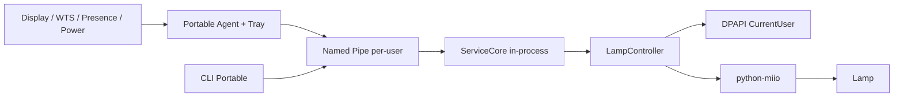
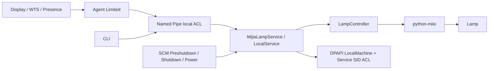

# MijiaLamp

[English](README.md) | [Español](README.es.md)

Local automation for compatible Xiaomi/Mijia lamps using `python-miio` on Windows 10/11.

**v3.1.3** offers two modes on the same policy/controller core:

| | Portable | Hardened Service |
|---|---|---|
| Administrator | No | Installation/maintenance only |
| Windows Service | No | Yes (`LocalService`) |
| Token | DPAPI `CurrentUser` | DPAPI `LocalMachine` + Service SID ACL |
| Display/WTS/User Presence | Yes | Yes |
| Tray and notifications | Yes | Yes |
| Physical sync/solar profiles | Yes | Yes |
| Works without a signed-in session | No | Yes |
| Can light the sign-in screen before entering Windows | No | Yes, with `service_prelogin_display` (pending a real Session 0 test) |
| Preshutdown/SCM Shutdown | Best effort | Yes |
| Python runtime | User `.venv` | Private copy, immutable to the user |
| Recommended for | Simple personal use | Maximum reliability and isolation |

> The public repository contains no IP, DID, MAC, coordinates, token, or state from a real installation.

## Installation and setup with the interface

On Windows, download and extract **`MijiaLamp-Setup-3.1.3.zip`** and double-click **`setup-gui.vbs` in File Explorer** as a standard user. The wizard opens without a console. `setup-gui.cmd` is also available as a launcher.

The first-run flow is **Language → Mode → Lamp → Settings → Install → Ready**. Choose English or Spanish on the Language page; the choice is saved as `ui_language` and can be changed later in Preferences by saving and reopening the editor. The interface, tooltips, tray, notifications, and application errors use the selected language. Windows errors that come from external components may remain in their original language.

The Setup package lets you choose Portable or Service; mode-specific ZIPs include only their mode. On the Lamp page, connect to Mi Home using a QR code and choose the device: its IP, model, and DID are checked on your local network and the token is encrypted. You can change the lamp from the same list while the wizard is open; refreshing the list requires another QR code.

On the Settings page, search for your **city** and confirm a result to fill in the time zone, latitude, longitude, and elevation. The global city search uses [Open-Meteo / GeoNames](https://open-meteo.com/en/docs/geocoding-api), with no account or key; it sends only the search term, never the token or lamp data. If a town does not appear, choose a nearby one or set the location manually under Advanced options. The lamp continues working without Internet after the location is configured.

Choose a **bedtime**, whether to automate **at night only or all day**, and whether to **follow the display (including while locked) or require an unlocked session**. In Service mode, following the display can light the keyboard before sign-in; Portable requires a signed-in session. With automatic dimming, the light dims starting two hours before bedtime and stays dim until sunrise. Custom profiles and schedules are in the advanced categories; hover over the **?** symbols for setting help.

On Install, preparation, encrypted token import, and the selected activation option are handled automatically. Service requests UAC once. The progress bar fills as stages and checks complete, showing the percentage and current task; it is not an estimate of time remaining. Messages update while work is in progress. On success it reaches 100%, Next becomes available, and going back or repeating installation is disabled; the bar disappears when you continue. You can leave automation disabled and enable it later from the tray icon.

The QR flow uses Xiaomi's cloud only during setup. The lamp must be linked to Mi Home and reachable from the PC over the local network to complete verification. Daily control remains local. The wizard does not save the Xiaomi session: it keeps only the selected token, encrypted with DPAPI, until import. If the QR or cloud flow fails, **Choose mi-tokens.json** lets you select a file obtained another way. The QR protocol and device queries are based on the MIT-licensed work in [mihome-ctl](https://github.com/daviddwlee84/mihome-ctl) and [Xiaomi-cloud-tokens-extractor](https://github.com/PiotrMachowski/Xiaomi-cloud-tokens-extractor); they may need maintenance if Xiaomi changes its services.

An official release includes Python. In a source checkout without a prepared runtime, the wizard prepares one automatically before connecting to Xiaomi: compatible Python is required and dependencies pinned by hash may be downloaded. You can test local code by opening `setup-gui.vbs`, without creating a branch or PR. The wizard uses the scripts, validations, and manifests described below and never saves the token in `config.json`. Local source installs of Service update their manifest during installation; downloaded packages retain and verify the release manifest.

The settings editor has tabs for the lamp, location, schedules, profiles, behavior, and advanced options. It validates every field with the project validator before saving. After installation, **Edit settings** from the tray icon opens the editor. Service requests UAC to apply changes and restarts the service and agent; in Portable, restart Portable from the tray icon after saving.

The Portable release includes Python. In a source checkout without a prepared runtime, automatic preparation may download dependencies pinned by hash. The commands below remain available for diagnostics, development, and automation, including manual import of `mi-tokens.json` if you prefer not to use a QR code.

Tray controls, manual timers, and pauses are explained in [Configuration](docs/configuration.md#tray-controls).

## Features

- Display ON/OFF, Suspend/Resume, WTS Lock/Unlock, and User Presence.
- Suspend preserves temporary overrides and Resume never turns the lamp on by itself: only a real Display ON can restore the profile.
- `PBT_APMRESUMEAUTOMATIC` does not invent presence or Display ON.
- Solar policy with Astral, stepped or continuous profiles.
- Manual overrides, temporary pause, and configurable handling of changes made from Mi Home.
- Reconciliation against physical `power`, `bright`, and `ct` values.
- Race protection through `intent_revision`/`critical_off_revision`.
- Synchronous/bounded critical Suspend OFF without discovery; Shutdown/Preshutdown use cancelable reassertion.
- Discovery: known IP → Windows Neighbor/MAC → mDNS → limited `/24` scan.
- Discovery cooldown/backoff and recovery from corrupt JSON caches.
- Rotating logs, token redaction, and strict configuration validation.
- Two explicit security runtimes: Portable `CurrentUser` and Service `LocalMachine`.

## Option A — Portable (recommended to start)

Portable does not install a service, write to `ProgramData`, or require elevated PowerShell. The **Portable release built by the workflow** includes a prepared private Python runtime: you do not need Python installed or to download dependencies. `setup-portable.ps1` verifies its hashes and creates local configuration and directories.

Portable starts after sign-in. It can keep controlling the lamp while the session is locked as long as the process remains active, but it cannot light the keyboard on the first sign-in screen after the PC starts. That scenario is for Service mode.

If you are working from a repository clone (without a packaged runtime), the same script creates `.venv` as a fallback and prepares dependencies as a standard user.

### 1. Extract and configure

Copy `config.example.json` to `config.json` and fill in at least:

- `lamp_ip`
- `expected_model`
- `device_id`
- location/time zone

### 2. Prepare as a standard user

```powershell
Set-ExecutionPolicy -Scope Process Bypass
.\setup-portable.ps1
```

If you already have a v2/v3 configuration, you can copy and migrate it safely:

```powershell
.\setup-portable.ps1 -ConfigPath "C:\path\config.json"
```

If that legacy configuration still contains a plaintext token, the migrator removes it from the JSON and encrypts it with DPAPI `CurrentUser`.

For an official Portable release, this **installs nothing**: it verifies `runtime-manifest.json` and the included self-contained runtime. In a source ZIP or clone without a runtime, it creates `.venv` in the folder and prepares dependencies without Administrator privileges.

For a source ZIP with a compatible `wheelhouse/`, `-Offline` prevents use of PyPI.

### 3. Import the token

```powershell
.\import-token.ps1 -Mode Portable
```

The token is encrypted with DPAPI `CurrentUser`: another Windows user cannot decrypt it.

### 4. Start

```text
start-portable.cmd
```

The tray icon appears. For diagnostics:

```powershell
& ".\runtime\python.exe" .\lampctl.py --mode portable runtime-status
& ".\runtime\python.exe" .\lampctl.py --mode portable doctor
```

Enable automation:

```powershell
.\enable-portable-automation.ps1
```

Optional autostart, without Administrator privileges:

```powershell
.\enable-portable-autostart.ps1
```

Revert it with `disable-portable-autostart.ps1`.

## Option B — Hardened Service

This mode prioritizes reliability during shutdown/suspend and separation of privileges.

### Verify a release before elevating privileges

If you downloaded an official ZIP that includes the runtime, verify the **original ZIP before extracting it** against this repository:

```powershell
gh attestation verify .\MijiaLamp-Service-VERSION.zip -R NicolasWeibel/mijia-lamp-automation
```

If verification fails or no attestation exists for the ZIP, do not run the installer elevated. The `.zip.sha256` file detects accidental changes, but by itself does not prove who published the ZIP. The attestation establishes build provenance; it does not guarantee the code or dependencies are free of malware. See [`docs/security.md`](docs/security.md) for the procedure and its limits.

The first publication of these changes must use the `v3.1.3` tag. Verify the corresponding ZIP; an attestation for another version does not cover this copy.

ZIPs built locally without `-IncludePreparedRuntime` are bootstrap packages without a prepared runtime. They require the preparation steps below and do not by themselves have the provenance of an attested official release.

### Installation principle

The elevated phase **does not download packages, run `pip`, or depend on a user-modifiable Python under `%LOCALAPPDATA%`**.

The flow is:

```text
standard user
  ↓
prepare-service-runtime.ps1
  ├─ downloads only pinned binary wheels
  ├─ builds a clean private copy of CPython
  ├─ installs dependencies without elevation
  ├─ removes pip/setuptools/wheel from the final runtime
  ├─ tests that the runtime is relocatable
  └─ generates a SHA-256 manifest for every file

Administrator
  ↓
install.ps1
  ├─ does NOT use the Internet
  ├─ does NOT run pip
  ├─ verifies every runtime hash
  ├─ validates config/runtime in staging
  ├─ performs a transactional swap
  ├─ installs LocalService + Service SID
  ├─ restricts RequiredPrivileges
  ├─ applies ACLs
  ├─ tests Named Pipe
  └─ runs security-check.ps1
```

Official releases built by GitHub Actions may already include `prepared-runtime/`; if so, local preparation is not needed.

### 1. Prepare the runtime (only if `prepared-runtime` is missing)

In a **standard** PowerShell session:

```powershell
.\prepare-service-runtime.ps1 -Recreate
```

### 2. Install

Open a new PowerShell session **as Administrator**:

```powershell
Set-ExecutionPolicy -Scope Process Bypass
.\install.ps1
```

The destination is:

```text
C:\ProgramData\MijiaLamp
```

Automation is disabled initially.

### 3. Token and diagnostics

```powershell
cd C:\ProgramData\MijiaLamp
.\import-token.ps1 -Mode Service

& ".\runtime\python.exe" .\lampctl.py service-status
& ".\runtime\python.exe" .\lampctl.py doctor
```

### 4. Manual test and activation

```powershell
& ".\runtime\python.exe" .\lampctl.py manual-on
& ".\runtime\python.exe" .\lampctl.py manual-off
.\enable-automation.ps1
```

Local security audit:

```powershell
.\security-check.ps1
```

To install and repeat Service tests directly from local changes, without a PR or release, follow [`docs/local-service-test.md`](docs/local-service-test.md).

## Architecture

### Portable



### Hardened Service



More detail: [`docs/architecture.md`](docs/architecture.md), [`docs/security.md`](docs/security.md), and [`docs/windows-integration.md`](docs/windows-integration.md).

## Security

Service mode applies measures including:

- `NT AUTHORITY\LocalService`, not `LocalSystem`;
- a dedicated Service SID;
- `RequiredPrivileges` reduced to `SeChangeNotifyPrivilege`;
- private Python runtime under `ProgramData`, not writable by the user;
- no dependency on the user's Python profile;
- `secrets/` has no ACE for the interactive user;
- code/runtime are `RX` only for the user;
- Named Pipe uses `PIPE_REJECT_REMOTE_CLIENTS`, the exact user SID, and the **dedicated Service SID** (no broad ACE for `LocalService`);
- no TCP listener;
- runtime prepared and hashed before elevation;
- elevated installer runs offline without `pip`;
- staging + second hash verification to close TOCTOU + recovery of files without running the old runtime as Administrator; after a failure, automation remains stopped until reinstalling from a verified release;
- `integrity-manifest.json` allows installed code/runtime to be revalidated;
- `security-check.ps1` checks invariants after installation.

Portable has a smaller footprint: it creates no service and needs no Administrator privileges, and the token is protected by DPAPI `CurrentUser`.

## Commands

Service mode (from the installation):

```powershell
& ".\runtime\python.exe" .\lampctl.py status
& ".\runtime\python.exe" .\lampctl.py doctor
& ".\runtime\python.exe" .\lampctl.py manual-on
& ".\runtime\python.exe" .\lampctl.py manual-off
```

Portable mode (official release):

```powershell
& ".\runtime\python.exe" .\lampctl.py --mode portable status
& ".\runtime\python.exe" .\lampctl.py --mode portable doctor
& ".\runtime\python.exe" .\lampctl.py --mode portable manual-on
& ".\runtime\python.exe" .\lampctl.py --mode portable manual-off
```

In a development clone without a packaged runtime, replace `runtime\python.exe` with `.venv\Scripts\python.exe`.

## Development

```powershell
python -m unittest discover -s tests -p "test_*.py" -v
python scripts/check_repository.py
pwsh -NoProfile -ExecutionPolicy Bypass -File scripts/check-powershell.ps1
```

Build releases:

```powershell
.\scripts\build-release.ps1
```

If `prepared-runtime` exists:

```powershell
.\scripts\build-release.ps1 -IncludePreparedRuntime
```

To prepare the public repository and publish versions using annotated tags, follow [`docs/github-setup.md`](docs/github-setup.md). Building a local ZIP does not publish a release.

## Compatibility

Designed and tested primarily with `yeelink.light.lamp22`. Other miIO models may expose different properties or ranges.

Python supported for preparation/Portable: **3.10–3.12 on Windows x64**. Dependencies are verified with SHA-256 hashes of wheels before installation.

## License

GPL-3.0-only. See [`LICENSE`](LICENSE).
